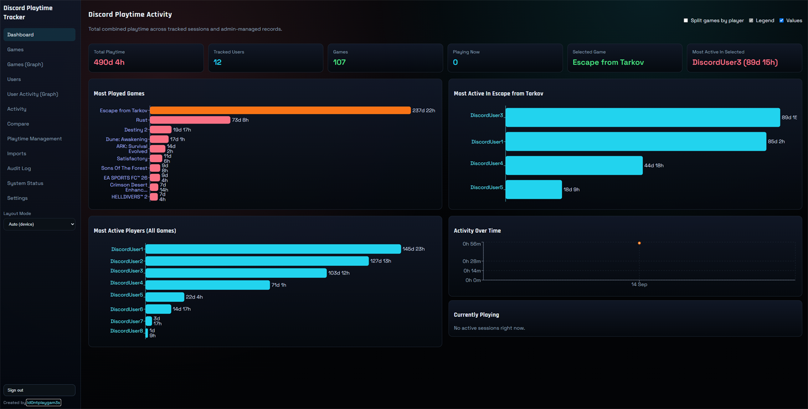

# Discord Playtime Tracker

Self-hosted Discord activity and playtime tracker for private communities.

Track game activity your bot can observe in Discord, combine it with historical/manual records, and keep all totals auditable through source records and admin audit logs.

## Dashboard Preview



## Table of Contents
- [What It Does](#what-it-does)
- [Getting Started](#getting-started)
- [Quick Install (No Clone, Public Images)](#quick-install-no-clone-public-images)
- [TrueNAS Example (Optional)](#truenas-example-optional)
- [Repository Install (Clone + Compose Files)](#repository-install-clone--compose-files)
- [Prerequisites](#prerequisites)
- [Discord Bot Setup](#discord-bot-setup)
- [Environment Variables](#environment-variables)
- [First Login](#first-login)
- [Usage: Imports](#usage-imports)
- [Usage: Games Admin](#usage-games-admin)
- [Operations](#operations)
- [Technical Reference](#technical-reference)
- [Troubleshooting](#troubleshooting)
- [Privacy and Legal](#privacy-and-legal)

## What It Does
- Tracks Discord observed activity sessions from `playing` presence events
- Shows per-user and per-game playtime totals
- Shows currently active sessions
- Supports historical/manual playtime (for pre-tracker hours)
- Supports manual positive/negative adjustments
- Writes audit log entries for admin changes
- Supports guest, user, and admin application access with role/permission enforcement
- Supports registration requests tied to known Discord users and admin approval
- Supports account lock/disable controls and administrator-managed password reset workflow
- Stores runtime feature/settings controls in PostgreSQL for persistence across container restarts

Tracker behavior highlights:
- Bot accounts are ignored for tracking and session logging.
- On startup, all non-bot guild members are synchronized (including offline members) so user lists are complete.

Important limitations:
- Discord activity is not an authoritative global playtime source like Steam.
- Historical Discord playtime cannot be reconstructed unless this tracker already captured it.
- Some activity may be hidden or unavailable depending on Discord privacy settings/intents/outages.
- Bot downtime can create missing observed time.
- Missing time is never faked; use manual adjustments for corrections.

## Getting Started

**TL;DR Quick Setup:**

1. [Create a Discord Bot](#discord-bot-setup) and get your token + guild ID
2. Copy `.env.example` to `.env` and fill in the required values
3. Run `docker compose up -d`
4. Run migrations: `docker compose exec discord-playtime-tracker-backend alembic upgrade head`
5. Open `http://localhost:4091` (or your server IP)

**⚠️ Security Note:** This app has no built-in HTTPS. Never expose the dashboard directly to the internet. Use Tailscale, a reverse proxy with Let's Encrypt, or another secure tunnel.

## Quick Install (No Clone, Public Images)
This is the quickest path if you just want the app running and do not need the repository locally.

1. Create an app directory with `config` and `postgres_data` folders.
2. Create `config/.env` and fill the required environment variables from the [Environment Variables](#environment-variables) section.
3. Create a `docker-compose.yml` file like this:

```yaml
services:
  discord-playtime-tracker-backend:
    image: id0ntplaygam3s/discord-playtime-tracker-backend:latest
    restart: unless-stopped
    depends_on:
      discord-playtime-tracker-postgres:
        condition: service_healthy
    env_file:
      - ./config/.env
    environment:
      PYTHONPATH: /app
    healthcheck:
      test: ["CMD", "curl", "-f", "http://localhost:8000/api/health"]
      interval: 20s
      timeout: 5s
      retries: 5

  discord-playtime-tracker-frontend:
    image: id0ntplaygam3s/discord-playtime-tracker-frontend:latest
    restart: unless-stopped
    depends_on:
      discord-playtime-tracker-backend:
        condition: service_healthy
    ports:
      - "4091:80"

  discord-playtime-tracker-postgres:
    image: postgres:17-alpine
    restart: unless-stopped
    env_file:
      - ./config/.env
    healthcheck:
      test: ["CMD-SHELL", "pg_isready -U \"$${POSTGRES_USER}\" -d \"$${POSTGRES_DB}\""]
      interval: 10s
      timeout: 5s
      retries: 5
    volumes:
      - ./postgres_data:/var/lib/postgresql/data
```

4. Start services:

```bash
docker compose pull
docker compose up -d
```

Migrations run automatically on startup.

5. Check health:

```bash
curl -fsS http://localhost:4091/api/health
```

6. Open dashboard:
- `http://SERVER-IP:4091`

## TrueNAS Example (Optional)
If you are using a TrueNAS dataset layout, this is a working example:

```yaml
services:
  discord-playtime-tracker-backend:
    depends_on:
      discord-playtime-tracker-postgres:
        condition: service_healthy
    env_file:
      - /mnt/Applications/discord-playtime-tracker/config/.env
    environment:
      PYTHONPATH: /app
    healthcheck:
      interval: 20s
      retries: 5
      test:
        - CMD
        - curl
        - '-f'
        - http://localhost:8000/api/health
      timeout: 5s
    image: id0ntplaygam3s/discord-playtime-tracker-backend:latest
    restart: unless-stopped
  discord-playtime-tracker-frontend:
    depends_on:
      discord-playtime-tracker-backend:
        condition: service_healthy
    image: id0ntplaygam3s/discord-playtime-tracker-frontend:latest
    ports:
      - '4091:80'
    restart: unless-stopped
  discord-playtime-tracker-postgres:
    env_file:
      - /mnt/Applications/discord-playtime-tracker/config/.env
    healthcheck:
      interval: 10s
      retries: 5
      test:
        - CMD-SHELL
        - pg_isready -U "$${POSTGRES_USER}" -d "$${POSTGRES_DB}"
      timeout: 5s
    image: postgres:17-alpine
    restart: unless-stopped
    volumes:
      - >-
        /mnt/Applications/discord-playtime-tracker/postgres_data:/var/lib/postgresql/data
```

## Repository Install (Clone + Compose Files)
Use this path if you want local project files and the repository-managed compose variants.

1. Clone and enter project:

```bash
git clone <your-fork-or-repo-url>
cd discord-playtime-tracker
```

2. Copy environment template and fill required values:

```bash
cp .env.example .env
```

> **Tip:** Generate a secure `SECRET_KEY` with: `python -c "import secrets; print(secrets.token_urlsafe(32))"`

3. Pull and start:

```bash
docker compose pull
docker compose up -d
```

Migrations run automatically on startup.

## Prerequisites
- Linux server/VPS (recommended) with Docker Engine + Compose plugin
- Discord bot token and guild ID
- Private access path (for example Tailscale)

## Discord Bot Setup

This tracker uses a Discord bot to observe `playing` presence events. The bot does **not** read messages, DMs, or voice content.

### Step 1: Create a Discord Application

1. Go to [Discord Developer Portal](https://discord.com/developers/applications)
2. Click **New Application** and give it a name
3. Navigate to the **Bot** section in the left sidebar

### Step 2: Configure Bot Intents

Under **Privileged Gateway Intents**, enable:

- **Server Members Intent** - Required to sync guild members on startup
- **Presence Intent** - Required to observe `playing` presence events

> Without these intents, the bot cannot see what games people are playing.

### Step 3: Get Your Bot Token

1. In the **Bot** section, click **Reset Token** (or **Copy Token** if already set)
2. Save this token securely - it will be used as `DISCORD_BOT_TOKEN` in your `.env` file
3. **Never share your bot token publicly**

### Step 4: Invite Bot to Your Server

1. Go to **OAuth2 → URL Generator**
2. Select scopes:
   - `bot`
3. Select permissions:
   - `View Channels` (under General Permissions)
4. Copy the generated URL and open it in your browser
5. Select your server and authorize

### Step 5: Get Your Guild ID

1. In Discord, open **User Settings → Advanced** and enable **Developer Mode**
2. Right-click your server icon
3. Click **Copy Server ID**
4. This is your `DISCORD_GUILD_ID`

### Step 6: App Verification URLs (Required by Discord)

Discord requires public URLs for Terms of Service and Privacy Policy when adding a bot to public servers. If your server is private, you can skip this. Otherwise, host these files publicly (e.g., GitHub Pages) and paste the URLs in:

**OAuth2 → General Information → Terms of Service URL**
**OAuth2 → General Information → Privacy Policy URL**

---

## Environment Variables

Copy `.env.example` to `.env` and configure the following values:

### Required

| Variable | Description | Example |
|----------|-------------|---------|
| `DISCORD_BOT_TOKEN` | Your Discord bot token from Developer Portal | `MTIzNDU2Nzg5...` |
| `DISCORD_GUILD_ID` | Discord server ID (snowflake, 17+ digits) | `123456789012345678` |
| `POSTGRES_USER` | PostgreSQL username | `tracker` |
| `POSTGRES_PASSWORD` | PostgreSQL password (use a strong password) | `s3cur3P@ss` |
| `POSTGRES_DB` | PostgreSQL database name | `tracker` |
| `DATABASE_URL` | Full database connection string | `postgresql+asyncpg://tracker:s3cur3P@ss@postgres:5432/tracker` |
| `ADMIN_USERNAME` | Bootstrap admin username | `admin` |
| `ADMIN_PASSWORD` | Bootstrap admin password (change after first login) | `Ch@ngeM3` |
| `SECRET_KEY` | JWT signing secret (generate a random string) | `a1b2c3d4e5f6...` |
| `WEB_PORT` | Port the frontend serves on | `4091` |
| `TIMEZONE` | Server timezone for display | `UTC` |

### Optional

| Variable | Description | Default |
|----------|-------------|---------|
| `STEAM_API_KEY` | Required only for Steam profile imports | (none) |
| `SESSION_RETENTION_DAYS` | Days to keep active sessions | (none - unlimited) |
| `RETENTION_CHECK_INTERVAL_MINUTES` | How often to check for expired sessions | `60` |
| `CORS_ALLOW_ORIGINS` | Comma-separated allowed origins | (none) |
| `APP_VERSION` | App version string | Auto-generated |
| `ACCESS_TOKEN_EXPIRE_MINUTES` | JWT token expiry time | `1440` (24h) |
| `DOCKERHUB_NAMESPACE` | Docker Hub namespace for images | `id0ntplaygam3s` |
| `APP_IMAGE_TAG` | Docker image tag | `latest` |

### Important: VITE_GUILD_ID

> **This is the internal database guild ID, NOT the Discord server ID (snowflake).**

The frontend needs the internal DB guild ID to query the API correctly. If you don't set this, the API will auto-resolve it when `VITE_GUILD_ID=0`.

**To find your internal guild ID after first start:**

```bash
docker compose exec discord-playtime-tracker-postgres psql -U "$POSTGRES_USER" -d "$POSTGRES_DB" -c "select id, discord_guild_id, name from guilds;"
```

**Recommended:** Set `VITE_GUILD_ID=0` initially and let the backend auto-resolve. Once you know the internal ID, you can set it explicitly.

## First Login
On login page:
- `Continue as Guest` gives immediate read-only viewer access.
- `User Sign In` authenticates approved user accounts linked to tracked Discord users.
- `Register` creates a pending account request for a tracked Discord user.
- `Admin Sign In` uses `ADMIN_USERNAME` and `ADMIN_PASSWORD` as bootstrap/recovery access.

Account and registration flow:
- Registration is limited to Discord users already tracked in the database.
- Pending registrations require admin approval before login is allowed.
- Administrators approve/reject from `Registrations`.
- Guest access can be disabled at runtime in `Settings`.

Password reset flow (self-hosted, no email dependency):
- User submits reset request from login page.
- Admin approves request in `Registrations`, receives one-time reset token.
- User completes reset with token on login page.

Admin-only pages are hidden/blocked for viewer sessions.

## Authorization Model
- Role defaults: `guest`, `user`, `admin`
- Permission enforcement is server-side for every protected API
- Effective permission precedence:
1. Per-user override
2. Role default
3. Guest/default fallback
4. Deny by default

Core permissions include:
- `dashboard.view`, `games.view`, `users.view`
- `playtime.view`, `playtime.manage_own`, `playtime.manage_all`
- `imports.manage`, `audit.view`, `registrations.manage`
- `users.manage`, `permissions.manage`, `settings.manage`

## Runtime Settings
Runtime settings are database-backed and editable from `Settings` by authorized admins.

Examples:
- guest access enabled/disabled
- registration enabled/disabled
- default role for approved registrations
- password policy and lockout controls
- user self-service manual playtime toggles

Secrets remain environment-managed and are not exposed in runtime settings:
- Discord bot token
- database credentials
- JWT secret
- bootstrap admin password

## Dashboard Ranges
Dashboard maintains independent state for:
- selected game
- selected-game activity range
- all-games activity range
- activity-over-time range

Most Played Games still defaults selected game to the first ranked game.
Most Active in Selected Game and Most Active Players (All Games) use independent date-range tabs.

Games and Games Graph pages now include a rows dropdown:
- Default 50 rows
- 30, 50, 100, 250 options
- All option for full overview
## Upgrade Notes

Schema updates are applied automatically on startup through Alembic:
- `0002_accounts_rbac_settings` - Added user accounts, RBAC, settings tables
- `0003_game_canonical_audit_actor` - Added game merge support and improved audit logging

This migration preserves existing tracked sessions, manual records, adjustments, users, games, and legacy admin login.

User cleanup:
- Admins can delete users from the Users page.
- Deleting a user removes associated tracked sessions/manual records/adjustments via database cascade.

## Usage: Imports
### Steam Profile Imports
Steam imports are optional and admin-only.

Configure in `.env`:

```env
STEAM_API_KEY=your_steam_web_api_key
```

Restart backend if changed:

```bash
docker compose up -d
```

Use in UI (`Imports` page):
1. Select Discord user.
2. Enter Steam profile URL, vanity name, or SteamID64.
3. Click `Preview Steam Games`.
4. Review detected games and playtime minutes.
5. Click `Import From Steam`.

Behavior:
- Imported Steam data is stored in `manual_playtime` with source `imported`.
- No fake activity sessions are created.
- Optional replace mode soft-deletes prior Steam imports from the same Steam profile tag before writing new records.

## Usage: Games Admin
The `Games Admin` page is available to users with `permissions.manage` and provides a UI for:
- Rename game titles
- Merge duplicate games into a canonical target
- Unmerge previously merged game identities
- Hide or unhide games from rankings/charts (for noise titles such as Spacewar)
- Review merge suggestions and ignore/accept them

Merge behavior:
- Merges are non-destructive
- Source records are hidden and linked to canonical targets
- Historical rows retain source provenance
- Aggregations resolve via canonical identity to avoid double counting

Visibility behavior:
- Hidden games are excluded from normal rankings/charts and list endpoints that only show visible games.
- Merged games stay hidden until unmerged; use `Unmerge` instead of `Unhide` for merged identities.

Related API endpoints:
- `GET /api/games/meta/catalog`
- `POST /api/games/{game_id}/rename`
- `POST /api/games/merge`
- `POST /api/games/{game_id}/unmerge`
- `POST /api/games/{game_id}/visibility`
- `GET /api/games/meta/merge-suggestions`
- `POST /api/games/meta/merge-suggestions/{source_game_id}/{target_game_id}/ignore`

### CSV Imports (Historical Data)
CSV header:

```csv
Discord User,Game,Hours,Minutes,Source,Note
John,Minecraft,1240,0,historical,Existing stats
```

Preferred header for safer matching:

```csv
Discord User ID,Discord User,Game,Hours,Minutes,Source,Note
155149108183695360,John,Minecraft,1240,0,historical,Existing stats
```

When `Discord User ID` is provided, import matching uses Discord IDs first (recommended), then falls back to name matching only when ID is missing.

Flow:
1. Preview
2. Validation report
3. Confirm import
4. Transactional write with audit

## Operations
### Check Services
```bash
docker compose ps
```

### Backups and Restore
Backup:

```bash
docker compose exec discord-playtime-tracker-postgres pg_dump -U "$POSTGRES_USER" "$POSTGRES_DB" > backup.sql
```

Restore:

```bash
docker compose exec -T discord-playtime-tracker-postgres psql -U "$POSTGRES_USER" "$POSTGRES_DB" < backup.sql
```

### Upgrade Procedure
```bash
git pull
docker compose pull
docker compose up -d
```

Migrations run automatically on startup.

## Technical Reference
### Architecture
- Backend: FastAPI, SQLAlchemy, Alembic, discord.py
- Database: PostgreSQL
- Frontend: React + TypeScript + Vite + Recharts
- Deployment: Docker Compose

### Repository Layout
- `backend/`: API, bot, services, models, migrations, tests
- `frontend/`: Dashboard SPA
- `docker-compose.yml`: default public-image deployment
- `docker-compose.build.yml`: local source build override
- `docker-compose.hub.yml`: optional explicit public-image compose
- `docker-compose.truenas.yml`: TrueNAS-style deployment using `config/.env` and bind-mounted postgres data
- `.env.example`: environment template

### API Summary
- `GET /api/health`
- `POST /api/auth/login`
- `POST /api/auth/guest`
- `GET /api/auth/me`
- `GET /api/system/status`
- `GET /api/stats/overview`
- `GET /api/stats/games`
- `GET /api/stats/users`
- `GET /api/stats/daily`
- `GET /api/stats/weekly`
- `GET /api/stats/monthly`
- `GET /api/activity/recent`
- `GET /api/activity/active`
- `GET /api/users/{user_id}`
- `GET /api/users/{user_id}/games`
- `GET /api/users/{user_id}/sessions`
- `GET /api/games/{game_id}`
- `GET /api/games/{game_id}/users`
- `GET /api/games/{game_id}/sessions`
- `POST /api/management/steam/preview`
- `POST /api/management/steam/import`

OpenAPI docs:
- `/docs`

### Alternative Deployments
Manual build from source:

```bash
docker compose -f docker-compose.yml -f docker-compose.build.yml up -d --build
```

TrueNAS-style deployment:

```bash
docker compose -f docker-compose.truenas.yml --env-file ./config/.env pull
docker compose -f docker-compose.truenas.yml --env-file ./config/.env up -d
```

The TrueNAS compose file expects:
- `./config/.env`
- `./postgres_data` directory for PostgreSQL persistence

Maintainer-only publish flow:

```bash
docker build -t <dockerhub-user>/discord-playtime-tracker-backend:<tag> ./backend
docker build -t <dockerhub-user>/discord-playtime-tracker-frontend:<tag> ./frontend
docker push <dockerhub-user>/discord-playtime-tracker-backend:<tag>
docker push <dockerhub-user>/discord-playtime-tracker-frontend:<tag>
```

### Tailscale Deployment Model
Recommended access model:
- Linux server
- Docker Compose stack
- Frontend on `WEB_PORT`
- Tailscale private network access

Do not expose PostgreSQL publicly.
Use Tailscale ACLs to restrict dashboard access.

### Development and Tests
Backend tests:

```bash
cd backend
pytest -q
```

Frontend checks:

```bash
cd frontend
npm run lint
npm run build
```

### Release Checklist
- `pytest -q` passes
- `npm run lint` passes
- `npm run build` passes
- `docker compose build` passes
- `docker compose up -d` healthy
- `/api/health` returns OK
- Guest and admin auth flows both work

## Troubleshooting
- **401 login**: verify `ADMIN_USERNAME`/`ADMIN_PASSWORD` and `SECRET_KEY`.
- **No live sessions**: verify bot intents (Server Members + Presence) are enabled and bot is in your server.
- **Status unavailable**: this is normal if the bot token is not configured. The tracker will still work for manual/historical data.
- **Steam import fails**: verify `STEAM_API_KEY` and profile visibility/identifier.
- **Empty dashboard or "Failed to load dashboard data"**: verify `VITE_GUILD_ID` is the internal DB guild id (query `guilds.id`) and not the Discord server ID. If `VITE_GUILD_ID=0`, the backend auto-resolves to the configured guild.
- **Postgres error `could not determine data type of parameter $4`**: update backend image to a version that includes typed casts for optional `from/to` filters, then recreate backend.
- **Bot not connecting**: check logs with `docker compose logs backend` for errors. Common causes: invalid token, missing intents, or bot not invited to the server.
- **Cannot access dashboard**: ensure you're using the correct port (`WEB_PORT`, default 4091) and that the frontend container is healthy.

## Privacy and Legal
Stored:
- Guild ID/name
- Discord user ID/username/display name/avatar URL
- Game names and app IDs
- Session timestamps
- Manual playtime and adjustments
- Audit logs

Not stored:
- Message contents
- DMs
- Voice audio

Legal documents:
- Terms of Service: [TERMS_OF_SERVICE.md](TERMS_OF_SERVICE.md)
- Privacy Policy: [PRIVACY_POLICY.md](PRIVACY_POLICY.md)
